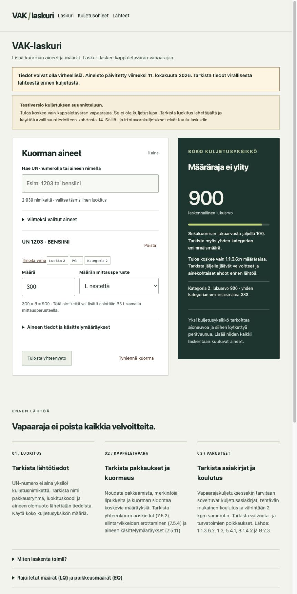

# Dangerous Goods Transport Calculator

English | [Suomi](README.fi.md)

**Dangerous Goods Transport Calculator (Finnish: VAK-laskuri) is a web calculator for the quantity exemption in road transport of dangerous goods.** It helps a driver build a load list, select the exact substance classification, and check the quantity calculation under VAK 2025 section 1.1.3.6.

**[Open Dangerous Goods Transport Calculator](https://sovietlabs.github.io/vak-laskuri/en.html)**

> Test version. Information may be incorrect or incomplete. The bundled dataset was last updated on **11 October 2026**. This version is updated manually. A deployment date is not a data update date. Verify the applicable official rules before transport. The result is not a transport approval.

## What the application does

- Searches 2,939 official Table A variants across 2,347 UN numbers.
- Keeps separate classifications and packing groups for the same UN number.
- Calculates the load's quantity exemption, including mixed loads and the category 1 footnote exceptions.
- Shows the remaining quantity for each selected variant under the quantity calculation.
- Requires the appropriate measurement basis, such as liquid volume, net mass, receptacle capacity, or net explosive mass.
- Shows classification, labels, LQ/EQ fields, packing codes, tunnel codes, handling instructions, and source links.
- Keeps up to ten recently selected variants in this browser and lets the user clear them.
- Prints a load summary and prepares data-error reports.

## How to use

1. Open the calculator. Select **English** in the top navigation if needed.
2. Search by UN number or Finnish substance name.
3. Select the exact classification, enter the quantity, and select its measurement basis.
4. Add all relevant substances in the complete transport unit.
5. Check the result, source provisions, and remaining obligations. Print a summary if needed.

The English interface is available at **[English calculator](https://sovietlabs.github.io/vak-laskuri/en.html)**. Official names and regulatory extracts remain in Finnish. Switching language clears the current load. Recent selections remain available.

## Käyttöohje

1. Avaa **[VAK-laskuri](https://sovietlabs.github.io/vak-laskuri/)**.
2. Hae aine UN-numerolla tai nimellä, esimerkiksi `1203` tai `bensiini`.
3. Valitse lähettäjän tietoja vastaava nimike. Tarkista luokituskoodi ja pakkausryhmä.
4. Syötä määrä ja valitse oikea mittausperuste. Desimaalierottimena voi käyttää pilkkua tai pistettä.
5. Lisää kuljetusyksikön muut laskentaan kuuluvat aineet. Ajoneuvo ja siihen kytketty perävaunu ovat samaa kuljetusyksikköä.
6. Tarkista tulos, ainekohtaiset määräykset ja jäljelle jäävät kuljetusvelvoitteet.
7. Tulosta yhteenveto tarvittaessa. Se ei korvaa vaadittuja kuljetusasiakirjoja.

Kuorma säilyy vain välilehden muistissa. Sivun uudelleenlataus poistaa kuorman. Viimeksi valitut nimikkeet säilyvät selaimessa, kunnes poistat ainehistorian tai selaimen sivustotiedot. Määriä tai kirjoitettuja hakusanoja ei tallenneta historiaan.



The example shows a quantity calculation. It is not a transport approval. The screenshot contains no optional image metadata.

## Calculation scope

Category is taken from Table A column 15. Packing group alone does not determine the multiplier.

| Category | Single-category maximum | Mixed-load multiplier |
| --- | --- | --- |
| 0 | No quantity exemption | Blocks exemption |
| 1 | 20 | ×50 |
| 1, footnote a | 50 kg | ×20 |
| 2 | 333 | ×3 |
| 3 | 1,000 | ×1 |
| 4 | No quantity limit under this section | ×0 |

Footnote a: UN 0081, 0082, 0084, 0241, 0331, 0332, 0482, 1005, and 1017. The mixed-load value must not exceed 1,000. The engine compares exact integer micro-units and does not round a value down to pass a threshold. Duplicate load rows are aggregated.

The remaining-quantity result assumes the same classification and measurement basis. It does not validate that substances may be loaded together.

### Not supported as automatic approvals

- Tank or bulk transport.
- LQ/EQ exemptions or other special-provision exemptions.
- Empty uncleaned packages, waste classifications, damaged batteries, or machinery provisions.
- Mixed-loading compatibility, route selection, tunnel decisions, national special cases, or security plans.
- Sea, ferry, air, or rail transport.

Some obligations remain below the quantity threshold. Verify classification, packing, marks, labels, securing, documents, training, extinguishers, supervision, and security requirements as applicable. Rule extracts can lose tables or formatting during extraction. Follow the links to the original annex for the complete text.

## Data and updates

This website reads the bundled **[data.json](docs/data.json)** and **[rules.json](docs/rules.json)** files. It does not query a live substance database. There is no scheduled update job in this repository.

To update the data, a maintainer must compare the official source, review the complete classification changes and calculation rules, run tests, update the displayed source date, and publish a reviewed change. Do not advance the data date when only code or documentation changes.

See **[DATA-SOURCES.md](DATA-SOURCES.md)** for the source edition, provenance, and the distinction between application licensing and regulatory material.

## Report an error

Select **Ilmoita virhe** on a search result or load entry.

- **Lataa ilmoitus** downloads a report without requiring an account. Nothing is sent automatically. You must deliver the report to a maintainer yourself.
- **Avaa ilmoitus GitHubissa** opens a draft issue in this repository. A GitHub account is required. Review the text and submit it there. Submitted issues are public.

You can also use **[GitHub Issues](https://github.com/sovietlabs/vak-laskuri/issues)**. Include the UN number, exact classification, dataset date, observed problem, expected value, and an official source where possible. Do not include names, customer information, credentials, or private load details.

Reports do not change the dataset automatically. An anonymous online submission API is not part of this static edition.

## Run locally

No package installation, build step, API key, or server application is required. Use a static HTTP server from the repository root:

```sh
python3 -m http.server 8080 --bind 127.0.0.1
```

Open `http://127.0.0.1:8080/docs/`. Opening the HTML directly as a file will not work because the browser must fetch local JSON and modules.

To reproduce the published project path, serve the repository from a parent folder named `vak-laskuri` and open `/vak-laskuri/docs/`, or use the path test described in [CONTRIBUTING.md](CONTRIBUTING.md).

## Repository layout

| Path | Purpose |
| --- | --- |
| `docs/` | Complete static website published by GitHub Pages |
| `docs/engine.mjs` | Quantity calculation and unit-basis rules |
| `docs/catalogue.mjs` | Catalogue and rule-data validation |
| `docs/history.mjs` | Bounded browser-local recent selections |
| `docs/backend-ui.mjs` | Static source-date display and report preparation; no backend calls |
| `docs/data.json` | Bundled substance variants and source hash |
| `docs/rules.json` | Extracted regulatory instructions and original PDF page references |
| `tests/` | Calculation, data-validation, and history tests |
| `scripts/check-release.py` | Export and image-metadata checks |

All browser source is readable in `docs/`. No generated binary application or hidden calculation service is required.

## Tests

Use a current supported Node.js version with the built-in test runner and Python 3:

```sh
node --test tests/*.test.mjs
python3 scripts/check-release.py
```

See [CONTRIBUTING.md](CONTRIBUTING.md) for change and review requirements. See [SECURITY.md](SECURITY.md) for security reporting and known boundaries.

## GitHub Pages settings

After release review, select **Settings → Pages → Deploy from a branch → main → /docs → Save**. Keep the custom domain empty to use the linked GitHub Pages address. A push to the publishing branch can update the website. Review changes before merging them.

## Privacy

There is no analytics script, tracking cookie, backend calculation, automatic report submission, or polling loop. The recent-substance list is stored in this browser profile and is shared by people who use that profile. Only variant IDs and the catalogue hash are stored. Clear the list on a shared device.

GitHub processes normal hosting requests. Clicking source links or the GitHub report button connects to those destinations. See [GitHub's privacy statement](https://docs.github.com/en/site-policy/privacy-policies/github-general-privacy-statement).

## Licence and status

Original application code is available under the **[MIT License](LICENSE)**. Source data and official regulatory text are identified separately in [DATA-SOURCES.md](DATA-SOURCES.md). The application is independent and has not been approved or endorsed by Traficom.

This is a test tool. Development tests do not establish legal compliance or certify it for operational transport decisions.
